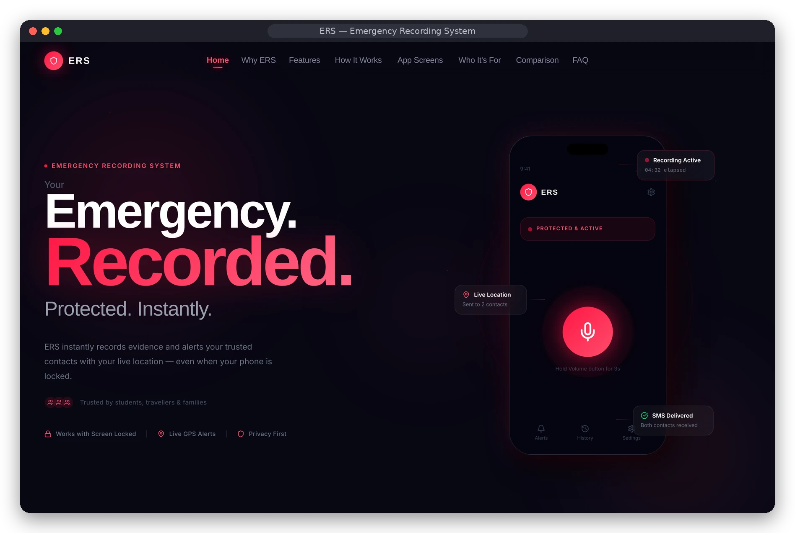
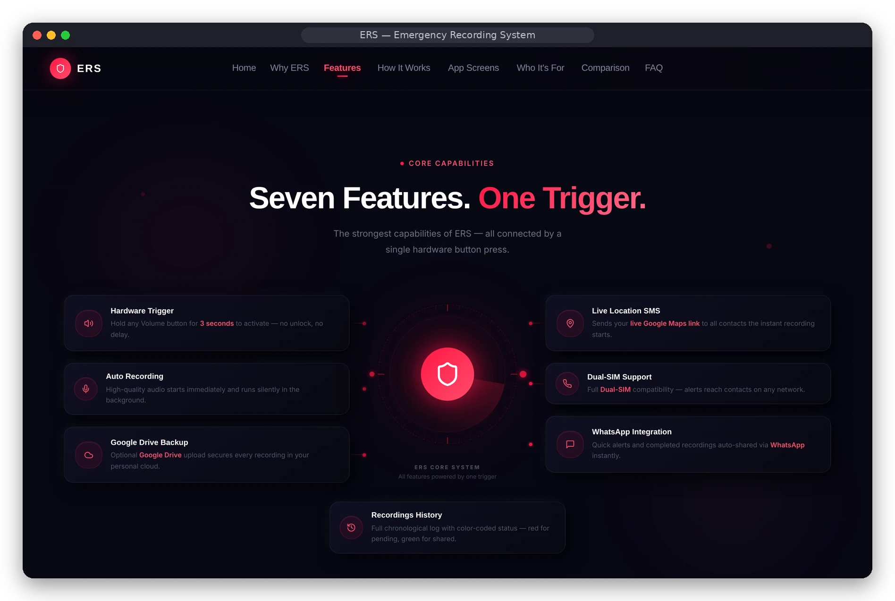
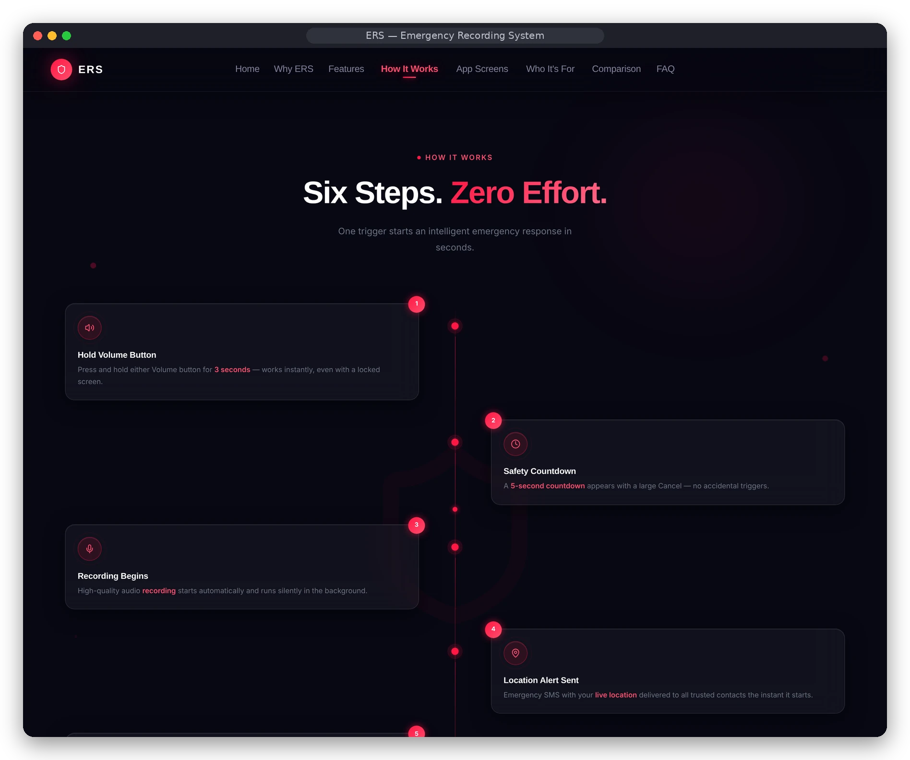
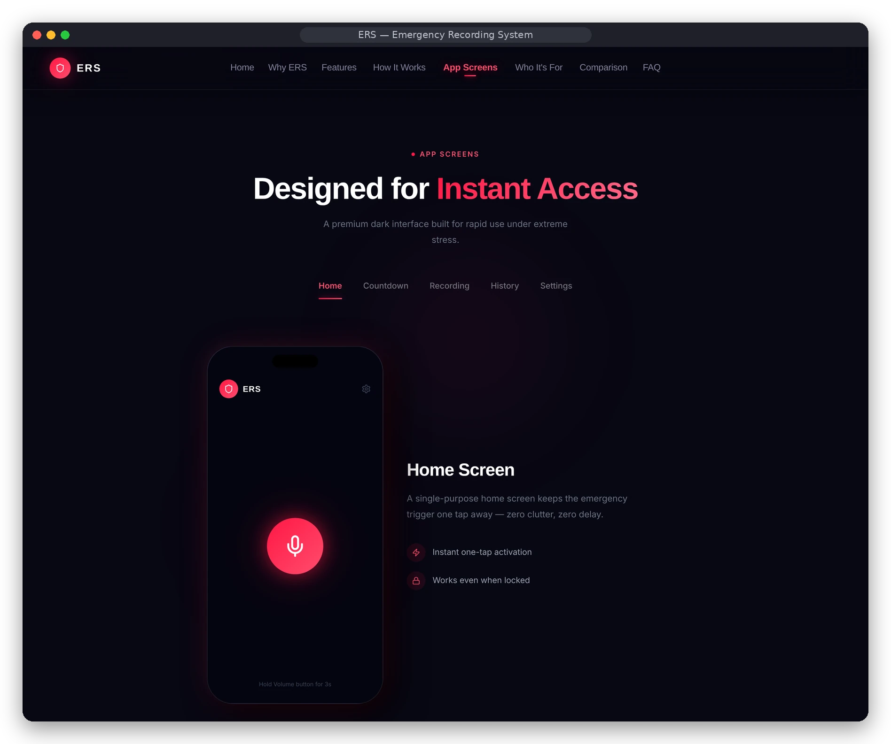
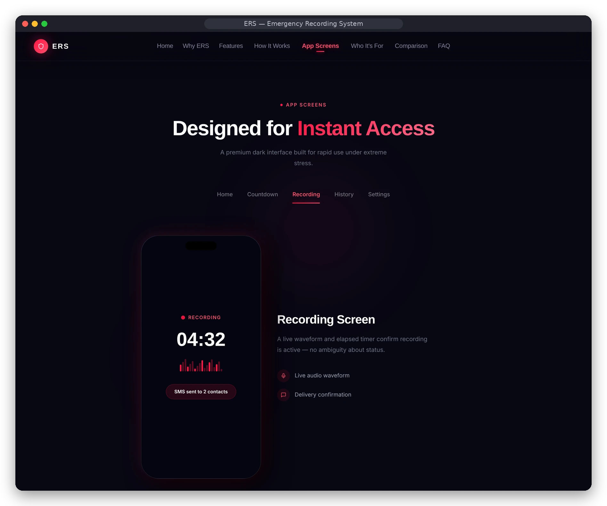
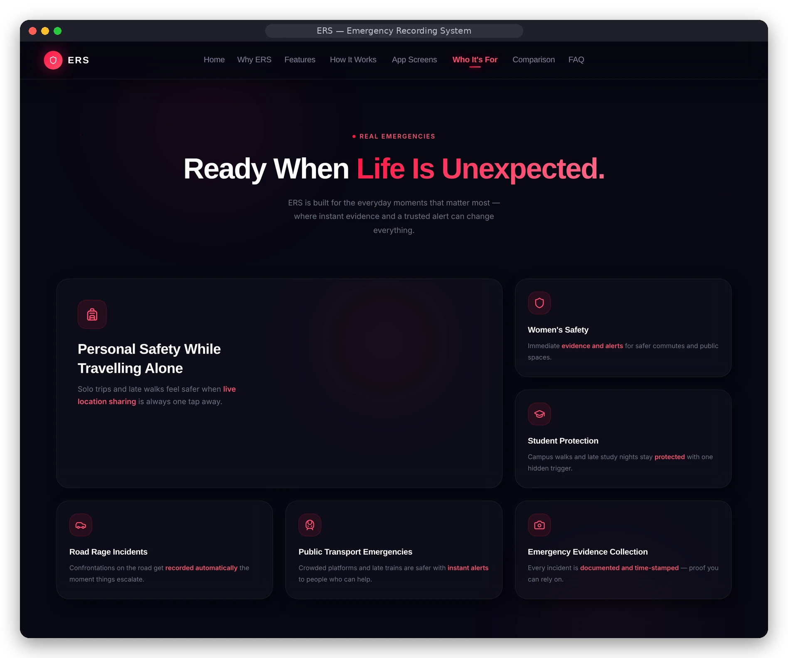
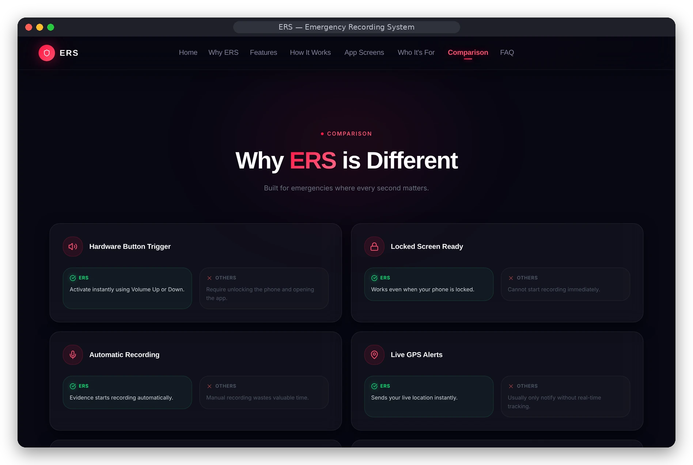

<div align="center">

# 🚨 ERS — Emergency Recording System
### *The product website for the ERS Android safety app*

[](https://emergencyrecordingsystem.vercel.app)
[](https://react.dev/)
[](https://www.typescriptlang.org/)
[](https://vitejs.dev/)
[](https://tailwindcss.com/)

[Live Site](https://emergencyrecordingsystem.vercel.app) · [Screenshots](#-screenshots) · [Run locally](#run-locally) · [Android App](https://github.com/kvalecha186-dot/ers-app)

<br/>



</div>

---
This repository contains the **ERS product website** — the public-facing website I built to explain the Emergency Recording System Android app and help people understand what it does.

ERS is designed for situations where someone may not have time to unlock their phone, open an app and manually start an emergency process. The idea is to make it possible to trigger an emergency recording workflow quickly, while also notifying trusted contacts.

This repository is the marketing and product-information website. It is **not the Android recording application itself**. The Android app is maintained in the separate [ers-app repository](https://github.com/kvalecha186-dot/ers-app).

## 📸 Screenshots

<table>
  <tr>
    <td width="50%"><br/><sub><b>Core capabilities</b> — seven features, one hardware trigger</sub></td>
    <td width="50%"><br/><sub><b>How it works</b> — six steps from trigger to alert</sub></td>
  </tr>
  <tr>
    <td width="50%"><br/><sub><b>App screens</b> — interactive showcase of the Android UI</sub></td>
    <td width="50%"><br/><sub><b>Recording screen</b> — live timer and delivery confirmation</sub></td>
  </tr>
  <tr>
    <td width="50%"><br/><sub><b>Use cases</b> — travel, women's safety, students and more</sub></td>
    <td width="50%"><br/><sub><b>Comparison</b> — why ERS differs from typical safety apps</sub></td>
  </tr>
</table>

> Screenshots are captured from the running website. The phone screens shown are the website's own product mockups of the Android app.

## What the website includes

- **Product introduction:** Explains the problem ERS is intended to address and the thinking behind the app.
- **Feature overview:** Presents the hardware-button trigger, audio recording, location alerts, WhatsApp sharing, recording history and backup-related capabilities.
- **How it works:** Walks visitors through the intended emergency workflow, from trigger to recording and contact notification.
- **App screen showcase:** Shows the main app screens and gives visitors an idea of the user experience.
- **Use cases:** Explains where an emergency recording and trusted-contact alert workflow may be useful.
- **Privacy and permissions information:** Introduces the sensitive permissions the Android app needs and why they are relevant.
- **Download links and calls to action:** Directs visitors towards the Android app.

The site uses a dark visual style with ERS red accents, responsive layouts, animated sections and mobile-app mockups to keep the product presentation consistent with the app.

## Tech stack

- React and TypeScript
- Vite
- Tailwind CSS
- React Router
- Motion-based animations
- Lucide icons

## Run locally

### Requirements
- Node.js
- npm

### Setup

```bash
git clone https://github.com/kvalecha186-dot/Emergencyrecordingsystem.git
cd Emergencyrecordingsystem
npm install
npm run dev
```

Create a production build:

```bash
npm run build
```

## Repository structure

```text
.
├── src/
│   ├── app/
│   │   ├── App.tsx
│   │   └── components/
│   ├── imports/
│   │   └── pasted_text/
│   │       └── ers-marketing-website.html
│   ├── main.tsx
│   └── styles/
├── index.html
├── package.json
└── vite.config.ts
```

## Important note about feature descriptions

The website explains the intended ERS product experience. Actual behaviour depends on the Android app, device permissions, Android version, background-service restrictions and the configuration of the user's phone. Please refer to the Android app source and test the workflow on a real supported device before treating every marketing statement as a verified capability.

## Related project

The Android application and its implementation are in:

[github.com/kvalecha186-dot/ers-app](https://github.com/kvalecha186-dot/ers-app)

## Why I built the website

I wanted ERS to be understandable before someone downloads it. The website gives the product a proper introduction, explains why the app exists, and shows how its main screens and emergency workflow are intended to work.
